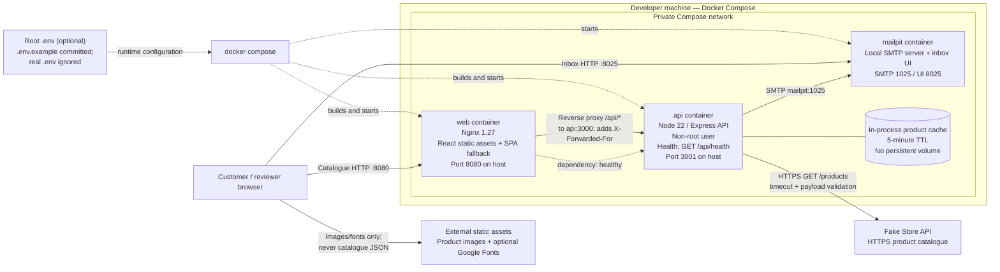
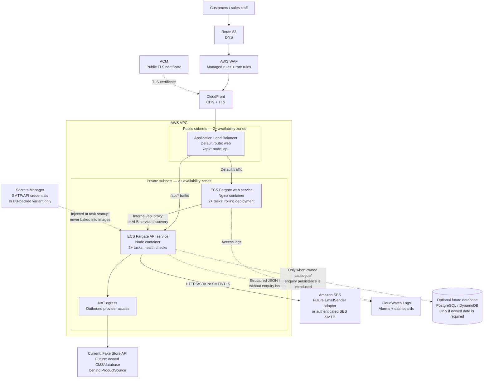
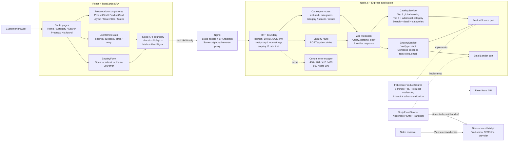
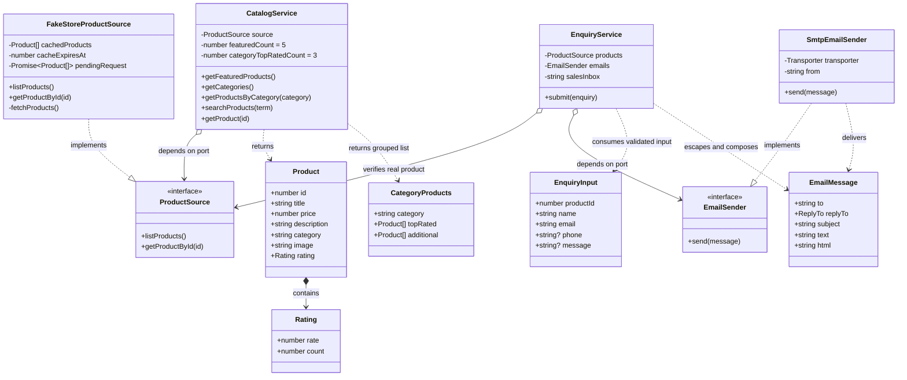
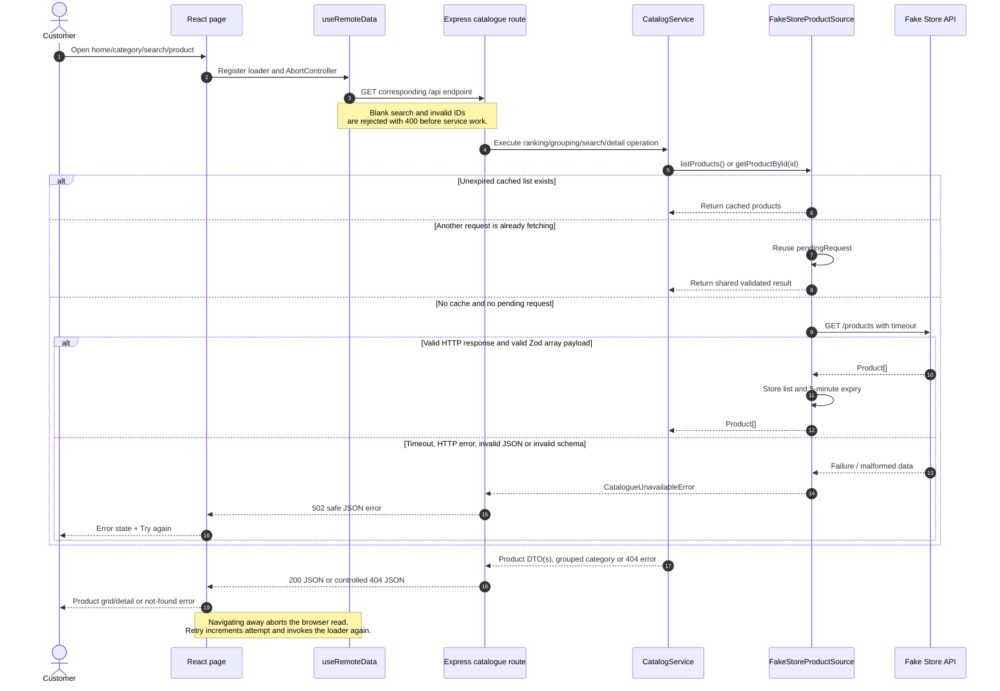
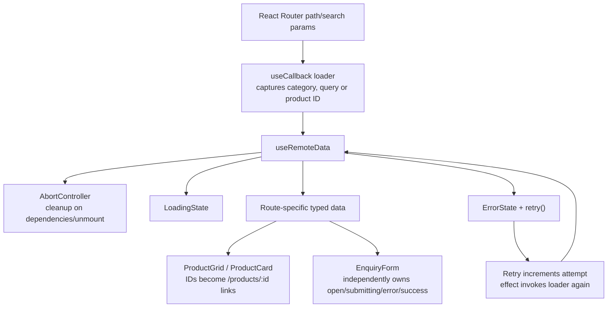

# Architecture diagrams

This document covers three levels of the Fieldwork design:

1. **Infrastructure:** what runs locally now, and a proposed AWS deployment path.
2. **HLD:** the major application components and their boundaries.
3. **LLD:** internal classes/interfaces, caching, validation and critical request sequences.

The local diagrams describe the implemented system. **AWS infrastructure is proposed only; it has not been provisioned and is not required to run this project.** All diagrams use Mermaid and render directly in GitHub/GitLab Markdown viewers.

---

## 1. Infrastructure diagram

### 1.1 Current local/Docker infrastructure



**Current properties**

- There is one private Compose network and no application database or persistent volume.
- The browser calls catalogue JSON only through same-origin `/api/*`; it never requests the Fake Store product endpoint.
- The API container also exposes port 3001 for direct health/API inspection. Nginx is the normal application entry point.
- Nginx waits for the API health check. Mailpit provides local-only email capture and is not a production email service.
- Product cache and Mailpit contents are local development state, not a durable application data store.

### 1.2 Proposed AWS production infrastructure (not provisioned)



**Deployment notes and trade-offs**

- This path preserves the existing two-container application. It does not introduce AWS dependencies into local development.
- Use separate target groups and health checks, deployment circuit breakers, autoscaling based on measured demand, TLS-only listeners, and a real `TRUST_PROXY` value matching the final hop topology.
- Run tasks in private subnets and restrict security groups to required paths. Restrict ALB ingress to CloudFront where practical.
- Replace Mailpit with SES only after sender/domain verification and production access requirements are satisfied. Keep Mailpit out of every public environment.
- NAT, ALB, ECS and CloudFront incur costs. Serverless/static hosting can simplify this later, but the diagram deliberately shows the smallest architectural migration from the current containers.
- Do not add the optional database or distributed cache until owned data, enquiry retention, multiple-instance consistency or measured scale requires them.

---

## 2. High-level design (HLD) diagram



### HLD responsibilities

| Boundary | Responsibility | Explicitly does not own |
|---|---|---|
| React pages/components | Navigation, accessible presentation, async UI state | Provider endpoints, ranking policy, recipient selection |
| Typed API client | JSON request/response envelope and HTTP error handling | Business filtering or direct third-party calls |
| Express routes | Path/query/body extraction, validation and response status | Provider-specific transformations or email composition |
| Catalogue service | Featured selection, category grouping, search and detail rules | React rendering, SMTP, Fake Store transport details |
| Enquiry service | Re-fetch product, create truthful email hand-off workflow | Trusting client title/price/recipient |
| ProductSource port | Replaceable catalogue read boundary | HTTP response rendering |
| EmailSender port | Replaceable email delivery boundary | Form state or product selection |
| Adapters | External protocol, timeout, schema/cache/transport details | Customer-facing presentation decisions |

---

## 3. Low-level design (LLD) diagram

### 3.1 Backend ports, services and data contracts



### 3.2 Catalogue request and cache flow



### 3.3 Enquiry delivery flow

```mermaid
sequenceDiagram
    autonumber
    actor Customer
    participant Form as EnquiryForm
    participant Limiter as IP rate limiter
    participant Route as POST /api/enquiries
    participant Schema as enquirySchema (Zod)
    participant Service as EnquiryService
    participant Products as ProductSource
    participant Mail as EmailSender
    participant SMTP as SmtpEmailSender
    participant Inbox as Mailpit sales inbox

    Customer->>Form: Enquire → enter details → Send enquiry
    Form->>Limiter: JSON body: productId, name, email,<br/>optional phone/message
    Limiter->>Route: Forward when within configured limit
    Route->>Schema: Parse and trim/validate untrusted body
    Schema-->>Route: Typed EnquiryInput or validation failure
    Route->>Service: submit(validated enquiry)
    Service->>Products: getProductById(enquiry.productId)
    Products-->>Service: Real provider product or null

    alt Product does not exist
        Service-->>Route: NotFoundError
        Route-->>Form: 404 NOT_FOUND
        Form-->>Customer: Retryable error; no thank-you
    else Product exists
        Service->>Service: Escape HTML fields, strip subject CRLF,<br/>compose text + HTML; set trusted sales recipient
        Service->>Mail: send(EmailMessage)
        Mail->>SMTP: sendMail(from, sales inbox, reply-to customer)
        SMTP->>Inbox: SMTP message hand-off
        alt SMTP accepts message
            Inbox-->>SMTP: Acceptance response
            SMTP-->>Route: Resolved
            Route-->>Form: 201 + Thank-you message
            Form-->>Customer: Replace form with Thank you status
        else SMTP fails/times out
            SMTP-->>Route: EmailDeliveryError
            Route-->>Form: 502 EMAIL_UNAVAILABLE
            Form-->>Customer: Keep form values and allow retry;<br/>do not show thank-you
        end
    end
```

### 3.4 Frontend module flow



### Validation and error rules

| Input/failure | Rule/result |
|---|---|
| Search | Trimmed string, 1–100 characters; blank returns 400, not the full catalogue |
| Product ID/category | Positive integer ID; non-empty category up to 100 characters |
| Enquiry name | Trimmed, 2–100 characters |
| Enquiry email | Valid email, maximum 254 characters |
| Enquiry phone/message | Optional; phone restricted to basic telephone characters and 30 characters; message maximum 2,000 characters |
| Request body | JSON only, maximum 10 KB; malformed JSON maps to 400, oversized body to 413 |
| Product/category lookup | Missing records map to controlled 404 |
| Provider failure | Timeout/non-2xx/invalid payload maps to safe 502 `CATALOGUE_UNAVAILABLE` |
| Email failure | Missing SMTP hand-off maps to safe 502 `EMAIL_UNAVAILABLE` |
| Enquiry volume | Default 5 attempts per IP per 15 minutes; excess maps to 429 |
| Unexpected failure | Generic safe 500; logs error name, method/path/status, never enquiry body |

These rules are enforced at the backend trust boundary; browser validation is only a convenience and is not treated as a security control.
